## Hi there, I'm Lenar 👋
 
**Frontend Developer & UI/UX Designer** from Baguio City, Philippines. I design interfaces in Figma and build them in React and TypeScript.
 

 
### About Me
- 💼 **Software Developer at ESCA** (Ecosystem for Sustainable Commerce in Agriculture), building React + TypeScript features backed by Supabase
- 🎨 I bridge design and code: high-fidelity Figma designs that I then ship as working UI
- 🎓 B.S. Computer Science, Saint Louis University, Baguio City
- 🏆 Dean's Lister · 2nd Place, MPTC Innovation Olympics 2024
### Featured Projects
| Project | What it is | Built with |
|---|---|---|
| [Amalzen Disease Diagnosis](https://github.com/DomingoLenar/Amalzen-Disease-Diagnosis) | Machine learning system that suggests diagnoses from patient symptoms and history | Python, TensorFlow, React |
| [RT-DETRv2 Mobile](https://github.com/DomingoLenar/RT-DETRV2-MOBILE) | Real-time object detection running on Android devices | PyTorch, Kotlin |
| [Cordillera Language Mapping](https://github.com/DomingoLenar/Cordillera-Language-Mapping) | Web app to discover the languages and dialects of the Cordillera region | JavaScript, HTML, CSS |
| [Cache Game](https://github.com/DomingoLenar/Cache-Game) | Browser game that trains memory and reaction time | JavaScript |
 
### Tech Stack
**Frontend**

 
**Backend & Data**

 
**Design & Tools**

 
### GitHub Stats

 
### Get in Touch

