## Hi there, I'm Lenar 👋
### About Me
---
- 🌱 Studied at Saint Louis University, Baguio City
- 💼 I mostly work on Frontend Development on projects

### Languages and Tools
---

  
  
  
  
  
  
  
  
  
  
  
  
  
  
  
  
  
  
  
  
  
  
  
  
  
  
  
  
  

### GitHub Stats
---

### Top Languages
---

### Connect with Me
---

